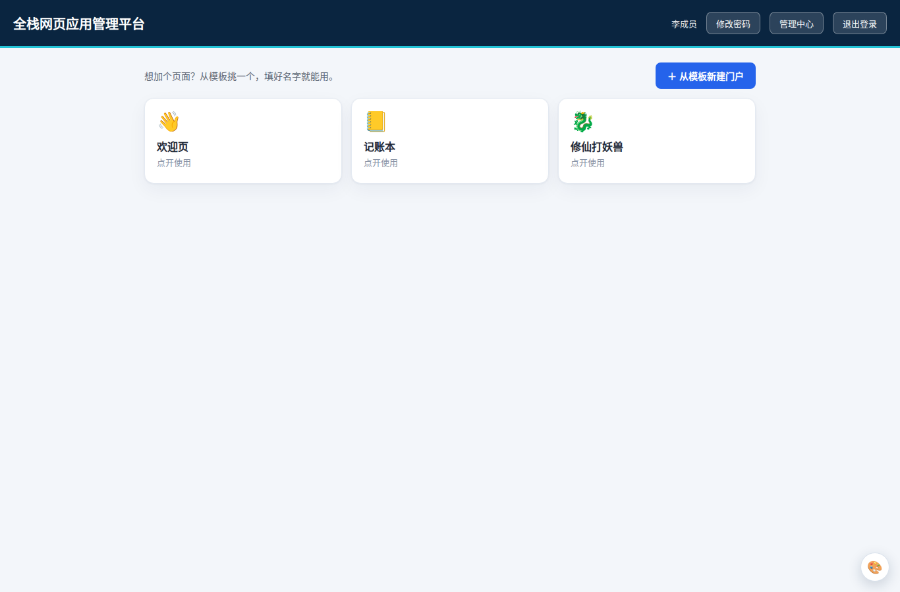
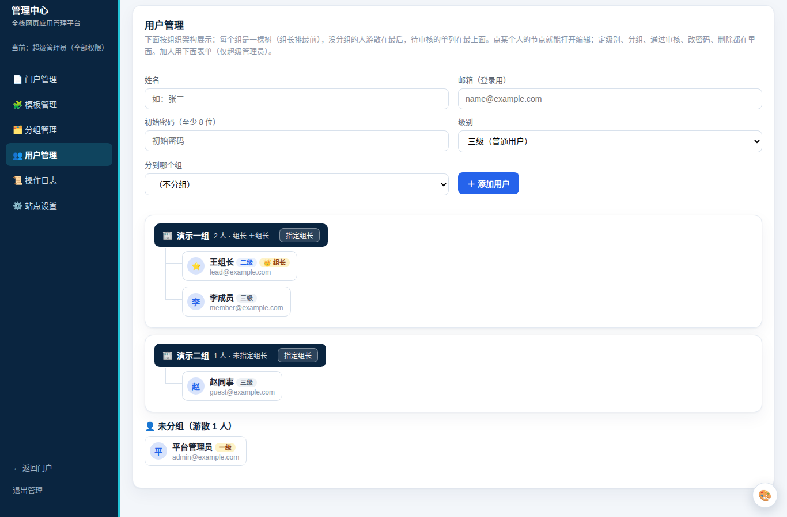
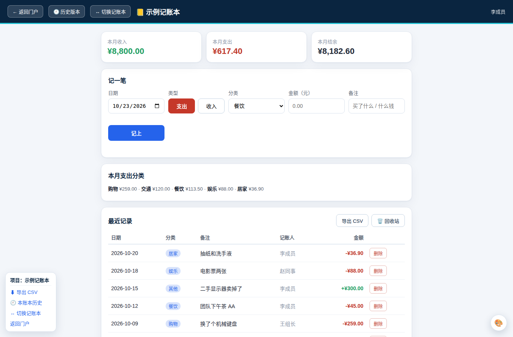
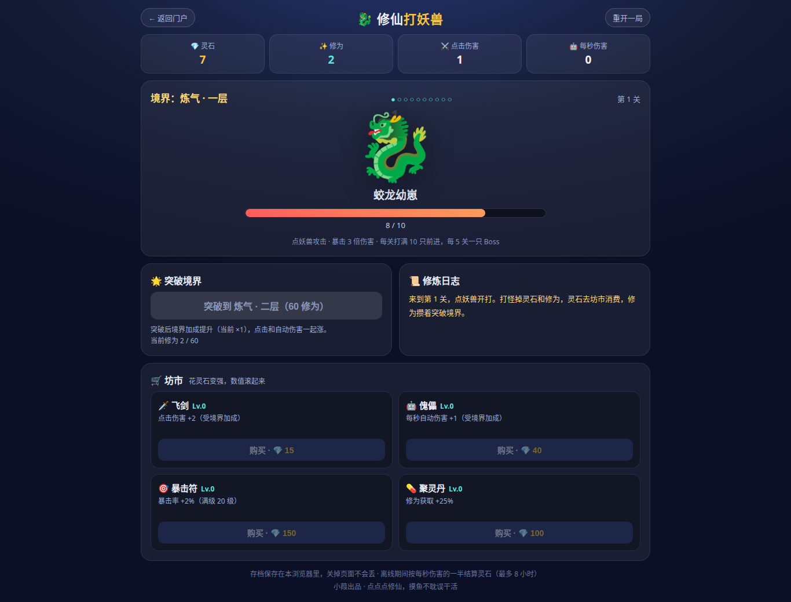

# 全栈网页应用管理平台

给工作团队用的轻量级网页应用托管与治理平台：同事把做好的网页应用交上来，平台负责账号、权限、门户、数据与历史版本。基于 [PocketBase](https://pocketbase.io)（单文件后端）实现，前端为原生 HTML/CSS/JS，无构建步骤。

> 本仓库是生产环境的**脱敏发布副本**：邮箱、姓名、域名、IP 已全部替换为占位值；不含生产数据、不含凭据文件。内部业务应用按要求未随仓库发布；除平台本体、「记账本」示例应用与「修仙打妖兽」小游戏外，另附一份可直接运行的**演示数据包**（虚构账号与示例数据，见下面的演示一节）。

## 先看效果：演示

仓库带一份开箱即用的演示数据包（`demo/`）：下载 PocketBase 后，把 `pb_public/`、`pb_hooks/` 和 `demo/pb_data/` 放到一起启动即可登录体验，演示账号见 [demo/DEMO.md](demo/DEMO.md)（密码统一 demo123456）。

门户（以成员身份登录）：



管理中心 · 用户管理（组织树：分组、组长、级别一目了然）：



示例应用 · 记账本（月度统计、分类汇总、记录列表与左下角的平台胶囊）：



示例应用 · 修仙打妖兽（平台托管的一个小游戏应用）：



## 功能

- **门户**：应用以卡片形式陈列；首页提供「从模板新建门户」向导（选模板 → 起名 → 定负责人/可见范围）。
- **模板**：平台部署时登记（公告页、图文页、链接页、通用记录页、应用型模板）；使用范围可设所有人 / 指定组（可多选）/ 指定人（可多选）。
- **三级权限**：一级（全局管理员）/ 二级（组长）/ 三级（普通成员）；自助注册 + 管理员审核；未审核账号可登录但读写全拒。
- **组织架构**：按分组的树形架构图；每个组可正式**指定组长**（groups.leader 字段），组长在树上置顶并带徽章；选三级成员当组长时会提示同时升为二级。
- **项目制应用**：一个「项目」= 一行平台数据（负责人 + 权限），项目下的业务数据全部挂在项目之下。权限四档：可读 = 全员 / 本组 / 仅负责人 / 指定人多选；可编辑同理；接口层（PocketBase API 规则）强制过滤，不是前端藏按钮。
- **管理中心治理**：门户管理与应用项目同处治理（改名、换负责人、改权限、发布/停用、回收站）；模板管理为只读清单，仅可调使用范围。
- **历史版本**：请求级钩子在改/删前自动整条快照（app_data、记账、门户、模板），支持一键恢复且恢复本身也留痕可反悔；每目标保留最近 50 版 + 180 天，服务器定时清理。
- **平台胶囊**：每个应用的项目页左下角有同款竖排小面板（项目名 / 导出 / 历史 / 切换项目 / 返回门户），位置形状全平台统一，配色随宿主应用。
- **主题色**：六种主题色（海蓝/青碧/翠绿/紫罗兰/蜜橙/玫红），每人按浏览器本地记忆，只影响自己看到的外壳页面。
- **其他**：操作审计日志；SMTP 邮件（找回密码/自助改密）；每日整库备份与异地副本。

## 架构

```
浏览器 ── HTTPS ──> 反向代理/隧道 ──> PocketBase (:8090, 仅监听本机)
                                       ├─ pb_public/   前端静态页（门户/管理中心/应用外壳）
                                       ├─ pb_hooks/    历史版本钩子（请求级，改删前快照）
                                       └─ pb_data/     SQLite 数据库 + 上传文件（不入库）
```

集合（见 `schema/collections.json`）：users（扩展 level/group/approved）、groups（name/note/leader）、pages、templates、app_data（应用与项目数据，project 自关联 + 范围字段）、jizhang_records、app_files、history、audit_logs、settings。

需求与设计取舍的完整说明见 `docs/全栈网页应用管理平台-需求文档.md`（平台的唯一准绳，含权限模型与变更记录）。

## 部署（简版）

1. 下载 PocketBase v0.32+ 二进制，建目录 `pb_data`、`pb_public`、`pb_hooks`，把本仓库的 `pb_public/`、`pb_hooks/` 内容放进去。
2. 启动：`./pocketbase serve --http=127.0.0.1:8090 --dir=./pb_data --publicDir=./pb_public`（systemd 示例见 `server/pocketbase.service.txt`）。
3. 创建超级管理员后，用超级管理员令牌调用 `PUT /api/collections/import` 导入 `schema/collections.json`（body：`{"collections": [...], "deleteMissing": false}`）。
4. 在 `/_/` 后台配置 SMTP 与站点 URL；创建第一个应用账号并设为一级。
5. 主账号保护：`pb_public/admin.html` 里搜 `admin@example.com`，换成你自己的一级账号邮箱（用于防误删/防降级主账号）。
6. 备份：`server/make-backup.sh`（整库打包留 3 份）+ 定时拉到 NAS；`server/prune-history.py` 每日清理历史版本。

注意：钩子文件里不要把逻辑抽到顶层函数——该版本 PocketBase 的 JSVM 中，钩子顶层定义在处理器内不可见，逻辑必须内联（详见需求文档实现注记）。

## 目录

| 路径 | 内容 |
|---|---|
| `pb_public/` | 前端页面与资源（门户 index、登录/注册/改密、管理中心 admin、记账本 jizhang、修仙打妖兽 xiuxian、历史 history、沙箱渲染 view、assets 主题与登录态） |
| `pb_hooks/` | history.pb.js 历史版本钩子 |
| `demo/` | 可直接运行的演示数据包（pb_data + 演示账号说明 DEMO.md，数据全为虚构） |
| `schema/` | 集合结构导出（可直接 import 到新 PocketBase） |
| `server/` | 备份脚本、历史清理脚本、systemd 单元示例 |
| `docs/` | 需求文档（唯一准绳）与截图（screenshots/） |
